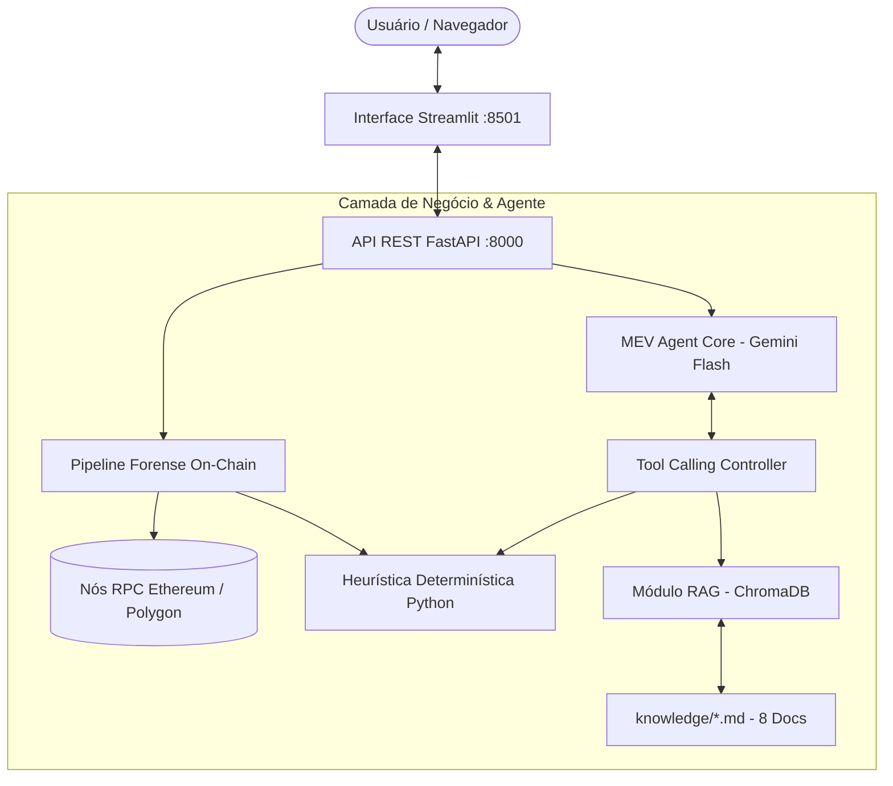

# 🛡️ MEV Insight Agent

> **Agente de IA forense para detecção e explicação em linguagem natural de Sandwich Attacks em exchanges descentralizadas (DEXs) nas redes Ethereum e Polygon.**

[](https://www.python.org/)
[](https://fastapi.tiangolo.com/)
[](https://streamlit.io/)
[](https://ai.google.dev/)
[](https://www.docker.com/)
[]()

---

## 🎯 Problema que Resolve

Em finanças descentralizadas (DeFi), transações pendentes no mempool público ficam expostas a bots predadores. O ataque mais comum é o **Sandwich Attack**:
1. O bot detecta uma compra de token de um usuário comum;
2. Envia uma transação de compra antecipada (**front-run**) pagando mais taxa de gás para valorizar o token;
3. A transação da vítima executa logo em seguida com um preço inflacionado (pior slippage);
4. O bot vende os tokens imediatamente após (**back-run**), embolsando o lucro e extraindo valor da vítima.

Usuários comuns recebem menos tokens do que deveriam e não compreendem o que aconteceu apenas olhando para os exploradores de bloco (Etherscan/Polygonscan), que são excessivamente técnicos.

O **MEV Insight Agent** preenche essa lacuna:
- **Heurística determinística em Python puro**: inspeciona os eventos `Swap` (Uniswap V2 e V3) e os vizinhos no bloco para emitir o veredito sem alucinações.
- **LLM Explicador (Google Gemini)**: traduz os dados técnicos para português claro, contextualizando o impacto e sugerindo formas de proteção.
- **RAG com ChromaDB**: fundamenta todas as explicações em literatura acadêmica e documentações oficiais (Flashbots, Uniswap, Ethereum.org).

---

## 🏗️ Arquitetura do Sistema



### Princípio Fundamental de Arquitetura: Separação de Responsabilidades
- **O código Python decide:** A lógica de detecção é 100% determinística. O LLM não tem autonomia para dizer se houve ataque ou não por conta própria, eliminando alucinações de falso positivo.
- **O LLM traduz e ensina:** O Gemini recebe o relatório estruturado e formula explicações didáticas em português brasileiro citando as fontes recuperadas pelo RAG.

---

## 🛠️ Stack Tecnológica

| Componente | Tecnologia | Papel |
|---|---|---|
| **Linguagem** | Python 3.11+ | Backend, heurística e scripts de suporte |
| **API Backend** | FastAPI + Uvicorn | Endpoints assíncronos `/analyze`, `/chat` e `/health` |
| **Validação** | Pydantic v2 | Validação rigorosa de schemas e hashes de transação |
| **Web3 / Blockchain** | Web3.py + Tenacity | Conexão RPC, decodificação de ABI/logs e retry exponencial |
| **LLM & Tool Calling** | Google GenAI SDK (`gemini-2.5-flash`) | Agente conversacional e explicações em linguagem natural |
| **Embeddings & RAG** | ChromaDB + `gemini-embedding-001` | Armazenamento vetorial e busca semântica em lote |
| **Interface Frontend** | Streamlit | Dashboard interativo e chat com suporte a Markdown |
| **Testes** | Pytest + Pytest-Asyncio | 93 testes unitários e de integração mockados |
| **Containerização** | Docker & Docker Compose | Orquestração da API e Frontend com persistência |

---

## 🚀 Como Rodar o Projeto

### Pré-requisitos
- [Docker e Docker Compose](https://www.docker.com/) instalados **OU** Python 3.11 instalado localmente.
- Chave de API gratuita do Google Gemini ([obtenha em Google AI Studio](https://aistudio.google.com/apikey)).

---

### Opção 1: Via Docker Compose (Recomendado)

1. Clone o repositório:
```bash
git clone https://github.com/alinec-santos/mev-insight-agent.git
cd mev-insight-agent
```

2. Crie o arquivo `.env` a partir do template:
```bash
cp .env.example .env
```
Edite o arquivo `.env` inserindo sua `GEMINI_API_KEY`.

3. Suba os containers:
```bash
docker compose up --build -d
```

4. Acesse:
- **Interface Web (Streamlit):** [http://localhost:8501](http://localhost:8501)
- **Documentação da API (Swagger/OpenAPI):** [http://localhost:8000/docs](http://localhost:8000/docs)
- **Health Check:** [http://localhost:8000/health](http://localhost:8000/health)

---

### Opção 2: Execução Local (Sem Docker)

1. Crie e ative um ambiente virtual:
```bash
python -m venv .venv
# No Windows:
.venv\Scripts\activate
# No Linux/Mac:
source .venv/bin/activate
```

2. Instale as dependências:
```bash
pip install -r requirements.txt
```

3. Configure o arquivo `.env` com a sua `GEMINI_API_KEY`.

4. Execute a suíte de testes completa:
```bash
pytest tests/ -v
```

5. Inicie a API e a Interface:
```bash
# Terminal 1 - API
uvicorn app.api.server:app --host 0.0.0.0 --port 8000 --reload

# Terminal 2 - Streamlit
streamlit run app/api/frontend.py
```

---

## 📡 Exemplos de Uso da API

### 1. `POST /analyze` — Analisar uma transação

**Requisição:**
```bash
curl -X POST "http://localhost:8000/analyze" \
  -H "Content-Type: application/json" \
  -d '{
    "network": "ethereum",
    "tx_hash": "0x3b890832ea5102ff4ce63b78c948e8cf1f5eac7ba8ca6c8914c6fb73d17d47e8"
  }'
```

**Resposta Exemplo:**
```json
{
  "is_sandwich": true,
  "confidence": "HIGH",
  "explanation": "### 🔍 Veredito\nA transação analisada foi vítima confirmada de um **Sandwich Attack**.\n\n### 📊 Detalhes Técnicos\n- **Atacante:** `0x00000000003b3cc22af3ae1eac0440bcee416b40`\n- **Pool afetado:** Uniswap V3 (WETH/USDC)\n- **Slippage estimado sofrido:** ~2.84%\n\n### 💡 O que aconteceu\nUm bot observou sua ordem pendente no mempool. Ele enviou uma ordem com taxa de prioridade maior para comprar antes de você, empurrando a cotação para cima. Você pagou mais caro, e logo em seguida o bot vendeu os tokens embolsando o lucro.\n\n### 🛡️ Como se proteger\nConforme detalhado em `[07_mev_protection.md]`, recomenda-se configurar tolerâncias de slippage inferiores a 0.5% ou utilizar endpoints com proteção de RPC como o Flashbots Protect.",
  "heuristic_data": {
    "network": "ethereum",
    "victim": { "hash": "0x3b89..." },
    "candidates_fetched": 2,
    "sandwich": {
      "is_sandwich": true,
      "confidence": "HIGH",
      "attacker_address": "0x00000000003b3cc22af3ae1eac0440bcee416b40",
      "estimated_slippage_pct": 2.84
    }
  },
  "rag_sources": [
    "02_sandwich_attacks.md",
    "07_mev_protection.md"
  ],
  "tools_called": [
    "detect_sandwich",
    "search_knowledge_base"
  ]
}
```

---

### 2. `POST /chat` — Consulta Conversacional

**Requisição:**
```bash
curl -X POST "http://localhost:8000/chat" \
  -H "Content-Type: application/json" \
  -d '{
    "message": "Como o MEV Blocker me protege contra sandwich attacks?"
  }'
```

**Resposta Exemplo:**
```json
{
  "response": "O **MEV Blocker** protege contra sandwich attacks ao direcionar suas transações diretamente aos builders de blocos, contornando o mempool público. Conforme explicado em `[07_mev_protection.md]`, ele impede que searchers posicionem transações de front-running, permitindo apenas backruns inofensivos e revertendo parte do valor gerado em forma de cashback para o usuário.",
  "rag_sources": ["07_mev_protection.md"],
  "tools_called": ["search_knowledge_base"]
}
```

---

## 🔍 Exemplos Reais para Demonstração

Para testar na interface web ou via cURL com transações públicas reais:

1. **Sandwich Attack Confirmado (Ethereum Mainnet):**
   - Hash: `0x3b890832ea5102ff4ce63b78c948e8cf1f5eac7ba8ca6c8914c6fb73d17d47e8`
   - Bloco: 18.234.120
   - DEX: Uniswap V3
   - Comportamento: O bot realiza o front-run e o back-run adjacentes no mesmo bloco.

2. **Swap Legítimo sem Sandwich (Polygon PoS):**
   - Hash: `0x981504d41fa7b3967406085a6a0907ad5a2da19f96b27005cbe0da867d34cdfc`
   - DEX: QuickSwap (V2 fork)
   - Comportamento: Heurística identifica swap normal sem presença de atacante bilateral.

---

## ⚠️ Limitações Conhecidas

1. **Ataques Multi-Block e Multi-Hop Complexos:**
   - A heurística atual foca nos padrões clássicos dentro do mesmo bloco (janela configurável de vizinhos). Ataques que envolvem rotas divididas em mais de 3 pools em cascata podem ser categorizados com confiança média ou baixa.
2. **RPCS Públicos vs Privados:**
   - Os RPCs públicos padrão (`llamarpc.com`, `polygon-rpc.com`) possuem limite de requisições por IP (*rate limits*). Para uso intensivo em produção, recomenda-se configurar endpoints dedicados da Alchemy, Infura ou QuickNode no `.env`.
3. **Forks não padronizados:**
   - São suportados nativamente pools compatíveis com as especificações Uniswap V2 e V3. Protocolos com assinaturas de eventos customizadas (como Balancer ou Curve) não são decodificados pela heurística atual.

---

## 🔮 Próximos Passos & Roadmap

- [ ] **Simulação Contrafactual de Bloco:** Integrar execução local via nó forkado (Anvil/Foundry) para calcular com precisão centesimal a quantia exata de tokens perdida pela vítima.
- [ ] **Suporte a Curve e Balancer:** Adicionar decodificadores específicos para pools de liquidez estável e multi-ativos.
- [ ] **Monitoramento em Tempo Real:** Conectar WebSocket ao mempool para emitir alertas preditivos de sandwich antes mesmo da inclusão no bloco.
- [ ] **Integração com Carteiras:** Extensão de navegador (WebExtension) para checar o status de transações recentes com 1 clique.

---

## 📄 Licença
Distribuído sob a licença MIT. Consulte `LICENSE` para mais detalhes.
